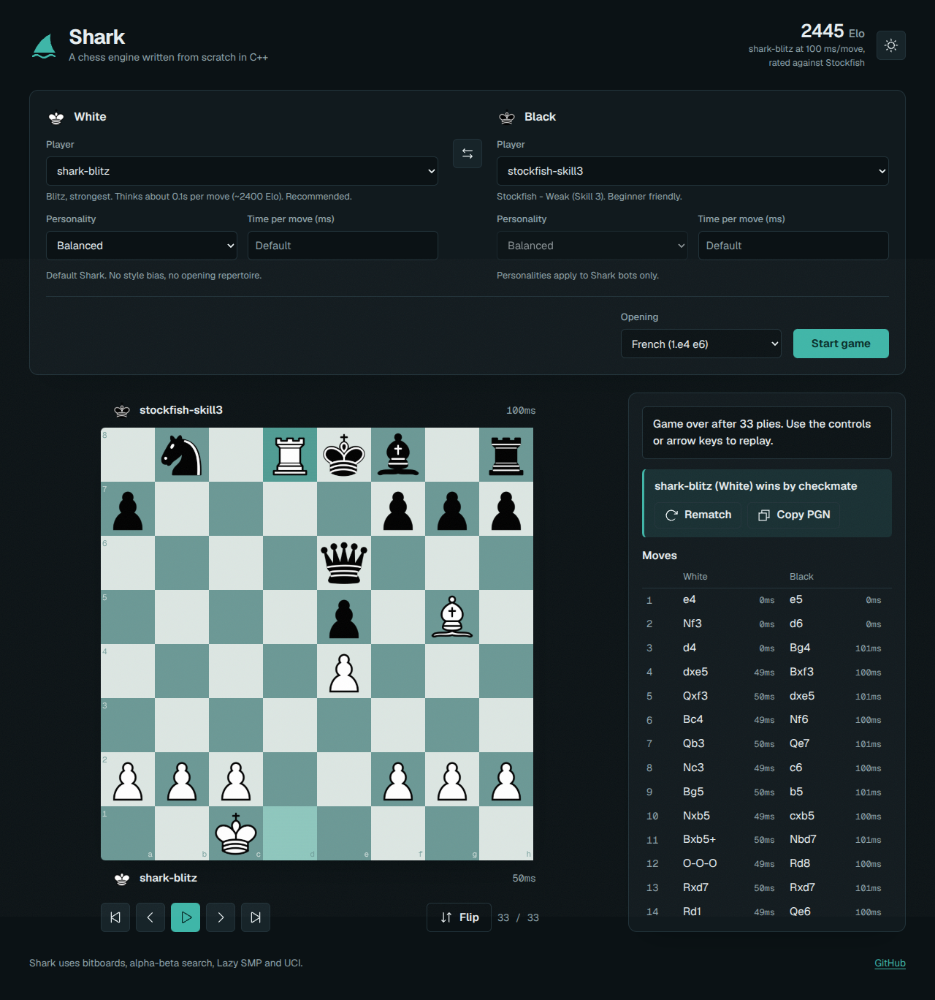

# Shark

Shark is a chess engine written in C++20. It has its own board, move generator, search, evaluation and UCI interface. Around it sit a Python arena for running matches and a browser app where you can play it or watch bots fight each other.

It plays at roughly **2445 Elo** at 100 ms per move, measured against Stockfish (details [below](#strength)).



[Demo video](https://github.com/Agam991/Shark/raw/main/shark-demo.mp4)
**Try Shark Chess Engine:** [Play Online](https://shark-r8ns.onrender.com/)

## What is from scratch

Everything that decides which move Shark plays is in `core/` and uses only the C++ standard library: board, move generation, search, evaluation, transposition table, threading and UCI.

The rest of the repo does use libraries:

- `tools/arena/` uses [python-chess](https://python-chess.readthedocs.io/) as a referee only. It checks legality and detects mate and draws. It never picks a move.
- `web/` uses Express, chess.js and chessboard.js for the browser UI.
- Stockfish is used as a reference opponent to measure strength.

## How it works

**Board.** Each piece type is a 64-bit number with one bit per square, so attacks and moves are fast bit operations. Move generation is checked with perft: the node counts match the published values (start position at depth 5 is 4,865,609).

**Search.** Iterative deepening negamax with alpha-beta pruning, plus the usual speed-ups: principal-variation search, quiescence search, check extensions, null-move pruning, late move reductions, and move ordering (hash move, captures, killer moves, history).

**Transposition table.** Positions are fingerprinted with a Zobrist hash and cached, so the same position reached by a different move order is not searched twice. The table is lockless so several threads can share it (Lazy SMP).

**Draws.** The search scores a repeated position as a draw and applies the fifty-move rule. A draw counts as slightly negative for the side searching (10 centipawns), so Shark avoids repeating when it is level or better, and takes the draw when it is clearly worse.

**Evaluation.** PeSTO piece-square tables, with separate middlegame and endgame tables blended by how much material is left.

**UCI.** Standard protocol, so Shark also works in other chess GUIs. Options: `Hash`, `Threads`, `Personality`, `PersonalityBook`.

## Personalities

A personality changes what Shark values, not how deep it searches. Each one adds its own evaluation terms and a small opening repertoire.

| Personality | Style |
|---|---|
| Balanced | The original Shark, no extras |
| Aggressive | King attacks, activity, space. Plays gambits |
| Defensive | Pawn shield, avoids weak pawns. Plays the London and Caro-Kann |
| Positional | Pawn structure, outposts, open files. Plays the English and Catalan |

The weights are in `core/src/personality.cpp`.

In a 300-game round robin ([docs/RESULTS.md](docs/RESULTS.md)) no personality was clearly stronger than the others. All differences were inside the margin of error. The weights are hand-picked and not tuned, so the personalities change style rather than strength.

## Strength

`tools.arena.calibrate` plays Shark against Stockfish at several `UCI_Elo` levels. The Elo where Shark scores 50% is the estimate.

`shark-blitz` at 100 ms per move, 20 games per level:

| Stockfish Elo | W / D / L | Score |
|---:|---:|---:|
| 2200 | 12 / 5 / 3 | 72.5% |
| 2500 | 3 / 12 / 5 | 45.0% |
| 2800 | 2 / 7 / 11 | 27.5% |
| 3050 | 0 / 4 / 16 | 10.0% |

Treat this as "about 2450 at blitz speed", not a rating-list number. The time control is fast and Stockfish's `UCI_Elo` is itself an approximation.

The four bots in `bots/` are the same engine with different limits: `shark-d4`, `shark-d6` and `shark-d8` search to a fixed depth, and `shark-blitz` gets 100 ms per move.

## Run it

**Build the engine and run the tests**

```bash
cmake -S . -B build -DCMAKE_BUILD_TYPE=Release
cmake --build build -j
ctest --test-dir build
```

On Windows with Visual Studio, add `--config Release` to the build command. The manifests in `bots/` point to `core/engine.exe`; on Linux and macOS change that to `core/engine`.

**Play in the browser**

```bash
cd web
npm install
npm start        # http://localhost:3000
```

Pick a human, a Shark bot or a Stockfish level for each side, choose a personality and move time, and press Start. Bot-vs-bot games stream live and you can step through the replay with the arrow keys.

**Arena tools** (needs `pip install -r tools/requirements.txt`, and Stockfish for gauntlets)

```bash
python -m tools.arena.cli royale --games 6                 # round robin of all bots
python -m tools.arena.cli gauntlet shark-blitz --games 20  # vs Stockfish
python -m tools.arena.calibrate --bot shark-blitz --games 12 --movetime 100
```

**Docker.** The `Dockerfile` builds the engine, installs the Python and Node dependencies and starts the web app on port 3000. It is set up for deploying on Render.

## Layout

```
core/    C++ engine (include/, src/, tests/)
tools/   Python arena: bot registry, matches, tournaments, calibration
bots/    bot manifests (JSON)
web/     browser arena (Node, Express)
docs/    screenshot, results, calibration data
bench/   search speed benchmark
```

CI builds the engine on Ubuntu and macOS and runs all tests, including perft, on every push.

## Known limits

- The strength numbers are blitz-speed estimates against Stockfish, not official ratings.
- The personality weights are hand-picked and untuned.
- Repetition and fifty-move detection were added after the personality tournament, which has not been rerun. The transposition table also ignores repetitions, so it can occasionally reuse a score that misses a draw.
- Opening repertoires are short.
- No endgame tablebases and no neural-network evaluation. The evaluation is hand-written.
- Promotions in the browser UI are always to a queen.

## Credits

- [Chess Programming Wiki](https://www.chessprogramming.org/)
- Sebastian Lague's [Chess-Coding-Adventure](https://github.com/SebLague/Chess-Coding-Adventure), the inspiration for this project
- PeSTO piece-square tables, from the Rofchade engine
- Chess piece images by Colin M. L. Burnett via Wikimedia Commons; jQuery, chessboard.js, chess.js (MIT/BSD); Geist fonts (SIL OFL); Phosphor Icons (MIT)
