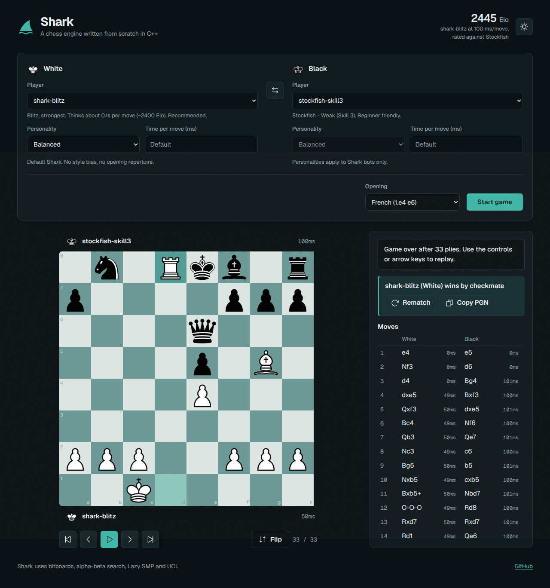

# Shark

Shark is a chess engine written from scratch in C++20. It has its own board,
move generator, search, evaluation and UCI interface, plus four playing
personalities and a browser arena where you can play it, watch it fight
Stockfish live, and replay every game.

**Strength:** about **2445 Elo** at 100 ms per move, measured against Stockfish
with calibrated `UCI_Elo` (see [Strength](#strength)).



*The browser arena. Bots play live with per-move think times, and you can scrub
back through the game afterwards.*

Watch a demo: [shark-demo.mp4](https://github.com/Agam991/Shark/releases/download/v0.1.0/shark-demo.mp4)

| Read next | |
|---|---|
| [docs/RESULTS.md](docs/RESULTS.md) | Hundreds of recorded games between the personalities, with analysis |
| [PERSONALITIES.md](PERSONALITIES.md) | Full reference for the personality system |
---

## Built from scratch

"From scratch" here means the engine itself uses no chess library. Everything
that decides which move Shark plays lives in `core/` and is written in C++20
with only the standard library:

- the board and move generator,
- the search and the evaluation,
- the transposition table and the multithreading,
- the UCI protocol.

Other parts of the repo use libraries, and it is worth being clear about where:

| Part | Uses | Why |
|---|---|---|
| `tools/arena/` (match runner) | [python-chess](https://python-chess.readthedocs.io/) | Referee only: legality checks, draw and mate detection, PGN. It never picks a move. |
| `web/` (browser arena) | chess.js, chessboard.js, Express | Rules for human moves in the UI, board drawing, and spawning the engine. |
| Calibration and gauntlets | [Stockfish](https://stockfishchess.org/) | An opponent of known strength to measure Shark against. |


| Phase | What was built | How it was checked |
|---|---|---|
| 0 | CMake build, project layout, a small test harness | Builds and passes on macOS, Linux and Windows |
| 1 | Bitboards, legal move generation, FEN parsing, make and unmake | **Perft** matches the published node counts on five standard positions |
| 2 | Evaluation, Zobrist hashing, transposition table, alpha-beta search | Tactic tests: finds mate in one, takes hanging pieces |
| 3 | UCI protocol | Handshake, options, `go` variants and `stop` covered by tests |
| 4 | Lazy SMP multithreading | Threaded search tests, `stop` interrupts `go infinite` cleanly |
| 5 | Bot registry (committed JSON manifests) | Manifest validation runs in CI |
| 6 | Tournaments, Elo and SPRT math | Strength ladder `shark-blitz` > `shark-d6` > `shark-d4` reproduced |
| 7 | Browser arena | Play, live bot-vs-bot streaming, scrubbable replay |
| 8 | CI and benchmark | Perft and the full test suite run on every push |
| 9 | Elo calibration against Stockfish | See [Strength](#strength) |
| After the plan | Personalities | Unit tests plus the tournaments in [docs/RESULTS.md](docs/RESULTS.md) |

---

## How the engine works

A move request travels through these layers:

```
 GUI / arena
     |  UCI text  ("position ... / go movetime 100")
     v
 uci.cpp          parses commands, sets options, manages time, prints "bestmove"
     |
     v
 search.cpp       iterative deepening, negamax with alpha-beta, quiescence
     |    ^
     |    |  stores and reads scores for positions already seen
     |    +-------------  tt.cpp  (lockless transposition table, shared by threads)
     v
 eval.cpp         scores a position: material and piece-square tables,
     |            plus the active personality's extra terms
     v
 board.cpp / movegen.cpp / bitboard.cpp / zobrist.cpp
                  the board, legal moves, attack tables, position hashing
```

### Board and moves

- **Bitboards.** Each piece type and colour is a 64-bit integer with one bit per
  square, using little-endian rank-file mapping. Attacks for knights, kings and
  pawns come from precomputed tables. Sliding pieces are ray-walked.
- **Legal move generation.** Pseudo-legal moves are generated, then moves that
  leave the king in check are filtered out. Castling checks every square the king
  passes through, and en passant has its own legality check.
- **Make and unmake** with an undo stack, so the search never copies the board.
- **Perft verified.** The node counts match the published values for the start
  position (depth 5: 4,865,609), Kiwipete (depth 4: 4,085,603) and the standard
  positions 3, 4 and 5. Perft is the correctness gate in CI, because one wrong
  move rule would silently corrupt everything above it.

### Search

The search looks for the move with the best score, assuming both sides play well.

- **Negamax with alpha-beta pruning.** One function scores both sides by
  flipping the sign. Alpha-beta skips branches that cannot change the result.
- **Iterative deepening.** Search depth 1, then 2, then 3 and so on, until time
  runs out. Each pass improves move ordering for the next, and there is always a
  complete answer ready when the clock stops.
- **Principal-variation search.** The first move at each node gets a full window.
  Later moves get a cheap null-window test and are only re-searched if they
  surprise the search.
- **Quiescence search.** At depth zero the search keeps going through captures and
  promotions until the position is quiet, which avoids misjudging a position in
  the middle of an exchange.
- **Check extensions.** A move that gives check is searched one ply deeper.
- **Null-move pruning.** If passing the turn still leaves a position good enough
  to cut off, the node is skipped. It is switched off in check, in principal-variation
  nodes, and when the side has no pieces besides pawns (where passing can be
  the worst move).
- **Late move reductions.** Quiet moves that come late in the move order are
  searched shallower first, and only searched fully if they beat the current best.
- **Move ordering.** Hash move first, then captures ordered by most valuable
  victim and least valuable attacker, then two killer moves per ply, then a
  history heuristic. Better ordering means more cut-offs.

### Transposition table

The same position often arrives by different move orders. The table is keyed by a
64-bit **Zobrist hash** that is updated incrementally on every move, and stores
the best move, score, depth and whether the score is exact or a bound. Mate
scores are stored relative to the position, so they stay correct when reused at a
different distance from the root. The table is **lockless**: each slot stores
`key XOR data`, so a thread that reads a half-written slot sees a key mismatch and
ignores it, with no locks.

### Multithreading (Lazy SMP)

With `Threads` above 1, each worker runs its own iterative-deepening search on a
private board and all of them share the transposition table. Workers drift to
different parts of the tree and feed each other through the table. The default is
one thread and the option is capped at the machine's core count. Search runs on a
background thread, so `stop` and `quit` work during `go infinite`.

### Evaluation

The base evaluation is **PeSTO**: separate piece-square tables for the middlegame
and the endgame, blended by how much material is left on the board. This lets the
king hide early and walk to the centre late.

Personalities add terms on top of this score. See below.

### UCI

Shark speaks standard UCI, so it also works in other GUIs and tournament tools.

| Option | Default | Meaning |
|---|---|---|
| `Hash` | 64 | Transposition table size in MB (1 to 4096) |
| `Threads` | 1 | Search threads (capped at the machine's cores) |
| `Personality` | Balanced | `Balanced`, `Aggressive`, `Defensive` or `Positional` |
| `PersonalityBook` | true | Use the personality's opening repertoire |

`go` accepts `depth`, `nodes`, `movetime`, `wtime`/`btime`/`winc`/`binc`,
`movestogo` and `infinite`.

---

## Personalities

A personality changes **how** Shark plays, not how deep it searches. It is two
things: extra evaluation terms, and a small opening repertoire. You can switch it
per side in the web UI at any time, even in the middle of a game.

| Personality | Style | Opening repertoire |
|---|---|---|
| **Balanced** | The original Shark. No extra terms. | None |
| **Aggressive** | Attacks the king, values activity, space and the bishop pair | King's Gambit, Evans Gambit, Grand Prix, Winawer (Qg4), Panov. Black: Najdorf, King's Indian |
| **Defensive** | Keeps its own king safe, avoids pawn weaknesses | London, Queen's Gambit Declined. Black: Caro-Kann, French Classical, QGD |
| **Positional** | Pawn structure, knight outposts, open files, passed pawns | English, Symmetrical English, Catalan, Reti. Black: Closed Ruy Lopez, Nimzo-Indian |

The weights, all in centipawns except where noted, live in one table in
`core/src/personality.cpp`:

| Term | Aggressive | Defensive | Positional |
|---|---:|---:|---:|
| Mobility, per reachable square | 2 | 1 | 3 |
| King attack, per unit of danger | 3 | 1 | 1 |
| Pieces near the enemy king | 3 | 0 | 0 |
| Own pawn shield | 0 | 12 | 6 |
| Penalty for attacks on own king | 0 | 3 | 1 |
| Doubled pawn penalty | 5 | 15 | 18 |
| Isolated pawn penalty | 5 | 15 | 14 |
| Passed pawn bonus (percent of base) | 110% | 80% | 130% |
| Rook on open file | 15 | 8 | 20 |
| Rook on semi-open file | 8 | 4 | 10 |
| Bishop pair | 20 | 15 | 35 |
| Knight outpost | 10 | 8 | 22 |
| Central control | 2 | 1 | 4 |
| Space | 4 | 0 | 1 |

King-related terms fade out as pieces come off the board. Openings are stored by
position (Zobrist key), not by move history, so transpositions still hit the book.
Out of book, the normal search takes over.

**Do the personalities work?** They change the evaluation and the opening, so
they play differently. Whether that makes them stronger or weaker is an open
question. In a round robin of 300 games at 30 ms per move
([docs/RESULTS.md](docs/RESULTS.md)), no personality was clearly different in
strength from the others: every head-to-head result was inside its margin of
error. The weights are hand-chosen and not tuned, which is the main reason.

---

## Strength

`tools.arena.calibrate` plays a bot against Stockfish at several `UCI_Elo` levels
with both sides on the same move time. Each level gives a score, and the headline
number is the Stockfish Elo at which Shark scores 50%.

`shark-blitz` at 100 ms per move, 20 games per level:

| Stockfish `UCI_Elo` | Wins | Draws | Losses | Score | Performance |
|---:|---:|---:|---:|---:|---:|
| 2200 | 12 | 5 | 3 | 72.5% | 2368 |
| 2500 | 3 | 12 | 5 | 45.0% | 2465 |
| 2800 | 2 | 7 | 11 | 27.5% | 2632 |
| 3050 | 0 | 4 | 16 | 10.0% | 2668 |
| 3190 | 1 | 3 | 16 | 12.5% | 2852 |

**About 2445 Elo** (50% crossover; near-even performance rating about 2488).

Read this as "plays at roughly 2450 at blitz speed", not as a rating-list number.
The time control is fast, Stockfish's `UCI_Elo` is itself an approximation, and
the performance rating is only averaged over levels where the score is between
20% and 80%.

---

## Quick start

### Build the engine

```bash
cmake -S . -B build -DCMAKE_BUILD_TYPE=Release
cmake --build build -j          # emits core/engine
ctest --test-dir build          # perft, search, UCI and personality tests
```

On Windows with Visual Studio, build with `--config Release`.

The bot manifests in `bots/` point at `core/engine.exe`. On Linux and macOS, change
the `engine` field in each manifest to `core/engine`.

### Set up the arena tools

```bash
python -m venv .venv
.venv/bin/pip install -r tools/requirements.txt     # Windows: .venv\Scripts\pip
```

Install Stockfish if you want an opponent for gauntlets and calibration
(`brew install stockfish`, `apt install stockfish`, or download it from
stockfishchess.org).

### Play in the browser

```bash
cd web
npm install
npm start          # http://localhost:3000
```

Pick White and Black (a human, any Shark bot, or a Stockfish level), choose a
personality and a move time for each Shark bot, and press Start game. Human games
are interactive. Bot-vs-bot games stream live, and the arrow keys, Home, End and
Space step through the replay.

### Arena commands

```bash
# round robin among the registered bots
python -m tools.arena.cli royale --games 6

# one bot against Stockfish, with an Elo estimate and an SPRT verdict
python -m tools.arena.cli gauntlet shark-blitz --games 20

# measure a bot's Elo against calibrated Stockfish
python -m tools.arena.calibrate --bot shark-blitz --games 12 --movetime 100

# round robin between the four personalities (writes docs/data/personalities.json)
python -m tools.arena.personality_tournament --games 50 --movetime 30
python -m tools.arena.render_results docs/data/personalities.json
```

### Benchmark

```bash
bench/bench.sh            # fixed-depth search over a standard position set
bench/bench.sh core/engine 9
```

---

## Repository layout

```
core/       C++ engine: include/, src/, tests/
tools/      Python arena: bot registry, match runner, tournaments, calibration
bots/       committed bot manifests (the roster)
web/        browser arena (Node and Express, plus chessboard.js)
docs/       screenshot, calibration data, results write-up
bench/      search speed benchmark
PLAN.md     development log
```

CI ([.github/workflows/ci.yml](.github/workflows/ci.yml)) builds the engine on
Ubuntu and macOS and runs the full test suite, including perft, on every push.

---

## Known limits

- The search has no repetition or fifty-move handling, so Shark cannot choose to
  seek or avoid a draw. In the personality tournament about 63% of games ended in
  threefold repetition.
- Evaluation weights for the personalities are hand-chosen and untuned.
- The opening repertoires are small and only cover the first moves of each line.
- Promotions in the browser UI are always to a queen.
- No endgame tablebases and no NNUE. The evaluation is hand-written.

---

## Third-party material

The web arena ships these files in `web/` so it works offline:

| Item | License |
|---|---|
| [jQuery](https://jquery.com/) 3.7.1 | MIT |
| [chessboard.js](https://chessboardjs.com/) 1.0.0 | MIT |
| [chess.js](https://github.com/jhlywa/chess.js) 0.10.3 | BSD 2-Clause |
| [Geist and Geist Mono](https://vercel.com/font) fonts | SIL Open Font License 1.1 |
| [Phosphor Icons](https://phosphoricons.com/) (inlined in `index.html`) | MIT |
| Chess piece images (`web/img/wikipedia/`) | Colin M. L. Burnett, via Wikimedia Commons. Check the license terms there before redistributing. |

## References

- [Chess Programming Wiki](https://www.chessprogramming.org/)
- Sebastian Lague, [Chess-Coding-Adventure](https://github.com/SebLague/Chess-Coding-Adventure), the inspiration for this project
- PeSTO piece-square tables, from the Rofchade engine
